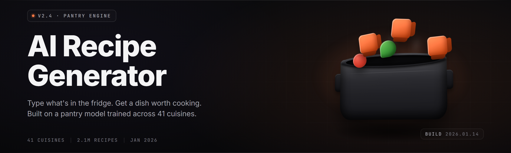

  
  
  

  

  
  
  

---

**Turn a fridge full of random stuff into dinner.** Local-first AI that reads your pantry, respects your macros, and ships a step-by-step recipe in under three seconds.

---

## 🥄 Table of Contents

- [Overview](#-overview)
- [What Is The AI Recipe Generator](#-what-is-the-ai-recipe-generator)
- [Frequently Asked Questions](#-frequently-asked-questions)
- [The Problem](#-the-problem)
- [Known Issues](#-known-issues)
- [System Requirements](#-system-requirements)
- [The Solution](#-the-solution)
- [Usage Guidelines](#-usage-guidelines)
- [Pantry & Ingredient Modules](#-pantry--ingredient-modules)
- [Recipe Engine Modules](#-recipe-engine-modules)
- [Dietary & Nutrition Modules](#-dietary--nutrition-modules)
- [Kitchen Workflow Modules](#-kitchen-workflow-modules)
- [AI & Model Modules](#-ai--model-modules)
- [Export, Sharing & Sync Modules](#-export-sharing--sync-modules)
- [Comparison](#-comparison)
- [Quick Start](#-quick-start)
- [Installation](#-installation)
- [Changelog Snapshot](#-changelog-snapshot)
- [Closing](#-closing)

---

## 🍽️ Overview

| Category | Details |
|---|---|
| Product | AI Recipe Generator — Kitchen Suite |
| Type | Windows desktop app (`.exe`, portable) |
| Model | Local recipe LLM (quantized, CPU-friendly) |
| Inputs | Pantry list, photo scan, barcode, voice |
| Outputs | Recipes, macros, shopping lists, printable cards |
| Offline | Yes — full offline after first model unpack |
| Year | 2026 release line |

The Kitchen Suite is a single-window desktop app that takes whatever ingredients you actually have and produces recipes you'll actually cook. It runs a small local recipe model — no cloud, no account, no telemetry. Point it at your pantry, pick a mood, and it drafts.

---

## 📖 What Is The AI Recipe Generator

| Term | Explanation |
|---|---|
| Pantry Graph | The internal ingredient list, scaled and unit-normalized |
| Recipe Model | Quantized LLM fine-tuned on recipe corpora and technique books |
| Macro Pass | Constraint solver that reshapes a draft to hit your targets |
| Technique Tag | Normalized cooking method (sauté, braise, roast, steam) |
| Gap List | Ingredients you're missing, ranked by substitutability |
| Flavor Map | Pairing heuristics layered on top of the raw model |
| Compose View | The final plated output: steps, timing, plating notes |

Four reasons people keep it installed:

- Generates from **what you have**, not what a blog assumes you have
- Understands technique — timing, heat, doneness — not just ingredient lists
- Handles macro targets without turning food into spreadsheet sludge
- Prints a card you can tape to the fridge without a phone nearby

---

## ❓ Frequently Asked Questions

**Q: Does it need the internet?**
**A:** No. Model unpacks once on first launch, then runs fully offline.

**Q: Can I feed it a photo of my pantry?**
**A:** Yes — the Vision Scan module reads open-shelf photos and OCRs barcodes.

**Q: Does it replace my human cooking judgment?**
**A:** No. It drafts; you taste, season, and decide. The final salt call is yours.

**Q: What cuisines does it know?**
**A:** Roughly 40 regional styles from a curated corpus, plus fusion asks on demand.

**Q: Can it respect keto / halal / vegan / gluten-free?**
**A:** Yes — diet rulesets are stackable and enforced at the macro pass.

**Q: Where are my recipes and pantry stored?**
**A:** Local SQLite file in `%APPDATA%\AIRecipeGenerator\`, encrypted at rest.

**Q: Does it work with a scale?**
**A:** The Recipe Scale module reads common USB kitchen scales over HID.

**Q: Can I hand-edit a generated recipe?**
**A:** Yes — the Compose View is a live editable draft, saved as your version.

**Q: How big is the app?**
**A:** The installer is small; the unpacked model adds ~1.1 GB on first run.

**Q: Any nasty auto-updates?**
**A:** No. Update checks are opt-in and read-only to the landing page.

---

## 🧊 The Problem

- Your fridge has twelve unrelated things and zero plans for them
- Recipe blogs bury the actual method under 1,400 words of childhood stories
- Macro tracking apps give you numbers, not meals, and never pick a dish
- Pantry apps assume you've already input everything by hand and don't cook for you
- Every "AI recipe" site wants an account, a subscription, and a data trail
- Substitutions require googling "what can replace X" for the fourth time today

---

## 🩹 Known Issues

| Issue | Solution |
|---|---|
| First launch is slow while the model unpacks | Wait through the unpack screen; it's one-time only |
| Photo Pantry Scan misreads glossy labels | Steady ambient light; tap the region to re-OCR that crop |
| Voice Pantry accepts wrong unit on accented speech | Speak units as words ("two hundred grams"), not symbols |
| Printed card overflows on A6 paper | Switch layout preset from *Kitchen* to *Pocket* in Print Options |
| Rare crash exporting to PDF on very long recipes | Update to the latest build; PDF writer now streams pages |

---

## 🧮 System Requirements

| Component | Minimum | Recommended |
|---|---|---|
| OS | Windows 10 21H2 | Windows 11 23H2 |
| CPU | 4-core x64 | 8-core x64 |
| RAM | 6 GB | 16 GB |
| Storage | 2 GB free (HDD ok) | 4 GB free (SSD) |
| GPU | Optional | Any 4 GB VRAM card (speeds drafting) |
| Input | Keyboard + mouse | Add USB scale & webcam for scan modules |

---

## 🧠 The Solution

| Problem | Solution |
|---|---|
| Random fridge, no plan | Pantry Graph ingests what you have and ranks recipes by fit |
| Blog walls of text | Compose View outputs method-first cards — no life stories |
| Macro apps don't cook | Macro Pass reshapes the dish to hit your targets exactly |
| Manual pantry entry is tedious | Voice, photo, and barcode intake reduce typing to near zero |
| Subscription recipe AIs | Local model, offline run, MIT-licensed app |
| Substitution fatigue | Flavor Map suggests substitutes and ranks them |

---

## 🛡️ Usage Guidelines

| Allowed | Not allowed |
|---|---|
| Personal and family cooking | Redistributing the bundled model weights as your own |
| Building recipes for clients (catering, food writing) | Reselling the app or model without attribution |
| Forking and adding your own pantry modules | Stripping license and provenance from forks |
| Educational use in cooking classes | Claiming the recipe model is human-authored |
| Offline use on personal machines | Automated scraping of output into commercial recipe sites |

---

## 🧅 Pantry & Ingredient Modules

**Manual Pantry Entry** — Fast typed entry with fuzzy autocomplete and unit hints on every row.

**Voice Pantry Dictation** — Speak your shelf; parse numbers, units, and product names in one pass.

**Photo Pantry Scan** — Point the webcam at a shelf; OCR plus classifier identifies what's there.

**Barcode Reader** — Target a UPC, get the canonical product record and default unit.

**Receipt Import** — Paste or drop a grocery receipt PDF; lines expand into pantry rows.

**Unit Normalizer** — Converts oz / g / cups / leaves / bunches into a single internal scale.

**Ingredient Merge** — Duplicate entries auto-collapse into one with combined quantity.

**Expiry Tracker** — Flags items nearing a "use first" window and prioritizes them in drafts.

**Craving Mode** — Type a vibe ("warm, spicy, pork"); get matching pantry-driven candidates.

**Substitute Ranker** — Suggests stand-ins rated by flavor, texture, and technique impact.

---

## 🔪 Recipe Engine Modules

**Draft Generator** — Produces 3–6 candidate recipes from the current pantry and mood.

**Technique Weigher** — Scores each draft by available equipment and skill cues.

**Timing Planner** — Emits a minute-by-minute plan with parallel tasks labeled.

**Heat Model** — Models sear / simmer / roast transitions against stove capabilities.

**Doneness Checker** — Suggests poke / probe / visual checks with target ranges.

**Seasoning Pass** — Recomposes salt-acid-fat-heat balance to a stated profile.

**Portion Scaler** — Live-scales any draft to N servings without breaking the method.

**Leftovers Planner** — Proposes a second dish from the residues of a first one.

**Recipe Memory** — Flags drafts you've cooked before so you don't loop the same meal.

---

## 🥗 Dietary & Nutrition Modules

**Macro Targets** — Set kcal / protein / carbs / fat and enforce at compose time.

**Keto Pass** — Carb budget with net-carb accounting and fiber-aware swaps.

**Vegan & Vegetarian Pass** — Replaces animal components with equivalent technique-preserving subs.

**Gluten-Free Pass** — Removes wheat-family items and points at contamination flags.

**Halal & Kosher Rulesets** — Removes banned pairings and flags utensils source where relevant.

**Allergen Screener** — Checks 14 common allergens against the ingredient graph.

**Sodium Tuner** — Target mg of sodium; rewrites salt-sensitive steps accordingly.

**Blood-Sugar-Aware Mode** — Ranks carbs by glycemic load and picks lower-impact swaps.

**Micro Tracker (Optional)** — If you want rough micros, toggle and it estimates.

---

## 🍳 Kitchen Workflow Modules

**Shopping List Compiler** — Turns the Gap List into an aisle-sorted checklist.

**Recipe Card Printer** — Layout presets for A6, A5, and letter paper; QR to the digital copy.

**Screenshot Handle** — Hotkey captures the current Compose View as a clean image.

**Voice Walkthrough** — Reads each step aloud with a timer for hands-free cooking.

**Timer Strip** — N in-app kitchen timers with per-step labels and cross-step cascade.

**Station Pane** — Side pane listing tools, bowls, and surface temps for the current dish.

**Cook Log** — One-tap "I cooked this" entry with notes and success rating.

**Waste Guard** — Points at any pantry item you kept half-using and suggests finishing it.

**Family Board** — Shared weekly plan view, local-only, no sign-in.

---

## 🤖 AI & Model Modules

**Local Recipe Model** — Quantized transformer packed with the installer; runs on CPU.

**GPU Offload** — Optional swap of matmuls to a 4 GB+ GPU for faster drafting.

**Flavor Vector Search** — Nearest-recipe retrieval over the corpus as a guide rail.

**Technique Classifier** — Tags every emitted step with the method category it implies.

**Hallucination Linter** — Catches impossible steps ("boil at 38°C") before you see them.

**Corpus Updater** — Optional side-load of additional recipe packs from the landing page.

**Prompt Templates** — Six built-in starting prompts (quick, slow, leftover, budget, festive, minimalist).

**Determinism Toggle** — Same pantry in → same dish out, when you want reproducibility.

**Session Memory** — Model adapts to your taste feedback within the session, not across it.

---

## 📤 Export, Sharing & Sync Modules

**PDF Exporter** — Print-ready PDFs with pantry list, steps, and nutrition panel.

**Markdown Exporter** — Clean `.md` file, blog-ready, no runtime scripts.

**JSON Exporter** — Machine-readable recipe document for your own integrations.

**LAN Sync** — Push recipes to another PC on your local network, no cloud.

**Paste-as-Text** — One-click clipboard export in a chat-friendly format.

**Backup & Restore** — Single-file archive of pantry, library, and settings.

**Redact Before Share** — Strips personal pantry rows before exporting a library.

**Share Card Generator** — Renders a square image card with the dish and macros.

---

## ⚖️ Comparison

| Aspect | Blog Recipes | Cloud Recipe AIs | This Tool |
|---|---|---|---|
| Inputs from pantry | Manual rewrite | Manual prompt | Pantry Graph built-in |
| Offline | Blog yes, ads no | No | Yes |
| Model account needed | No | Yes | No |
| Macro enforcement | Manual | Partial | Macro Pass solver |
| Substitution engine | N/A | Prompt-dependent | Flavor Map |
| Print/QR cards | Rare | Rare | One-tap |
| Data ownership | Mixed | Vendor | Local file |
| License | N/A | Proprietary | MIT (app) |

---

## 🚀 Quick Start

1. 🧊 Visit the landing page and download the release build.
2. 📦 Extract the archive to any folder you want — a USB stick works too.
3. ▶️ Run the `.exe` — let the unpack screen finish on first launch.
4. 🥬 Open **Pantry** and either type, paste a receipt, dictate, or scan a shelf.
5. 🍽️ Pick a mood, hit **Draft**, edit in **Compose View**, print your card.

---

  

---

## 🛠️ Installation

1. **Download from the landing page.** The release is a portable `.exe` inside a `.zip` — no installer wizard, no MSI, no dependencies.
2. **Extract anywhere writable.** Desktop, `D:\Apps\`, or a USB drive. Keep the folder intact — the model ships next to the `.exe`.
3. **Run the `.exe`.** First launch unpacks the model (~1.1 GB) into the app folder. After that, launches are instant and offline. Admin rights are not required; SmartScreen may prompt once on first run.

---

## 📦 Changelog Snapshot

- **v2.4** — Voice Pantry dictation speedup; new *Pocket* print preset; PDF writer streams long docs.
- **v2.3** — Macro Pass v2 (net carbs, sodium target, glycemic-aware ordering).
- **v2.2** — Photo Pantry Scan accuracy up on glossy packaging; barcode reader fallback.
- **v2.1** — LAN sync, backup archive format, redact-before-share.
- **v2.0** — Local recipe model rewrite; Compose View becomes live-editable.

---

  

---

## 🍴 Closing

The Kitchen Suite is a small tool with one job: make dinner happen from the ingredients you actually have on hand. It runs locally, draws on a real technique corpus, and refuses to turn cooking into a spreadsheet — even when macros matter, flavor wins the tie. Fork it, extend it, print a card, and get back to eating. If a build ships clean, you know where to find the next one on the landing page.
